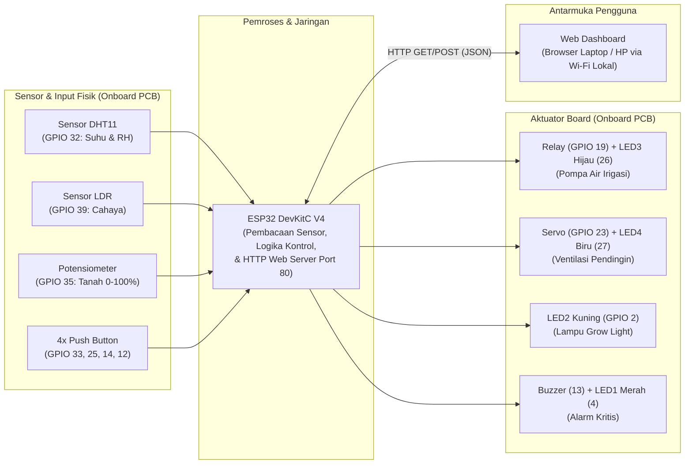

# LAPORAN PROJECT AKHIR INTERNET OF THINGS (IoT)

---

## 1. Judul, Latar Belakang, dan Tujuan

### Judul Project
**Smart Mini Greenhouse Monitoring & Control System Berbasis Trainer Kit ESP32 DevKitC V4 dan Antarmuka Web Lokal**

### Latar Belakang
Pemeliharaan tanaman di dalam rumah kaca (*greenhouse*) membutuhkan pemantauan kondisi lingkungan mikro secara terus-menerus, terutama suhu udara, kelembapan udara, intensitas cahaya, dan kelembapan media tanam. Perubahan suhu yang terlalu panas atau keterlambatan penyiraman dapat menghambat pertumbuhan tanaman. Pemeliharaan secara manual sering kali tidak konsisten dan memakan waktu.

Dengan memanfaatkan teknologi *Internet of Things (IoT)* berbasis **Trainer Kit ESP32 DevKitC V4 (38-Pin)**, parameter lingkungan di dalam *mini greenhouse* dapat dibaca secara *real-time*, dikirimkan melalui jaringan Wi-Fi lokal, ditampilkan pada antarmuka Web Dashboard yang informatif, serta mengendalikan aktuator (pompa irigasi via relay, ventilasi otomatis via motor servo, pencahayaan tambahan *grow light*, indikator LED, dan alarm buzzer) baik secara **otomatis** maupun **manual**.

### Tujuan
1. Merancang dan mengimplementasikan sistem monitoring & kendali *Smart Mini Greenhouse* berbasis ESP32 DevKitC V4.
2. Menghubungkan ESP32 ke jaringan lokal (Wi-Fi Hotspot/Router) dan menyajikan data sensor secara *real-time* melalui JSON REST API dan Web Dashboard.
3. Mengimplementasikan mekanisme pengendalian aktuator (Relay Pompa, Motor Servo Ventilasi, LED Grow Light, dan Buzzer) secara otomatis berdasarkan *threshold* sensor maupun kontrol manual melalui antarmuka web dan 4 tombol fisik onboard.

---

## 2. Daftar Alat dan Bahan

| No | Nama Komponen | Jumlah | Fungsi dalam Sistem |
| :---: | :--- | :---: | :--- |
| 1 | **All-in-One Trainer Kit ESP32 DevKitC V4 (38-Pin)** | 1 unit | Mikrokontroler utama, konektivitas Wi-Fi, dan papan integrasi sensor & aktuator |
| 2 | **Sensor `DHT11` (Onboard)** | 1 buah | Membaca suhu udara (`°C`) dan kelembapan udara (`% RH`) |
| 3 | **Sensor `LDR` + Resistor Pembagi Tegangan (Onboard)** | 1 buah | Membaca intensitas cahaya (`%`) melalui pin analog `ADC1` |
| 4 | **Knop `Potensiometer` (Onboard)** | 1 buah | Sensor/simulator input kelembapan media tanam (`0–100%`) |
| 5 | **Modul `Relay` 1-Channel (Onboard)** | 1 buah | Saklar elektronik pengendali Pompa Air Irigasi |
| 6 | **Motor `Servo SG90` (Onboard)** | 1 buah | Aktuator pembuka/penutup ventilasi atap *greenhouse* (`0°–90°`) |
| 7 | **`Buzzer` Onboard** | 1 buah | Alarm peringatan suara saat kondisi lingkungan kritis |
| 8 | **4× `LED` Indikator Onboard** | 4 buah | `LED1` Merah (Alarm Kritis), `LED2` Kuning (Grow Light), `LED3` Hijau (Pompa), `LED4` Biru (Ventilasi) |
| 9 | **4× `Push Button` Onboard (`Button1`–`Button4`)** | 4 buah | Kontrol fisik mode (`AUTO`/`MANUAL`) serta toggle manual Grow Light, Pompa, dan Ventilasi |
| 10 | **Kabel Data Micro-USB & Laptop/Smartphone** | 1 set | Pemrograman ESP32, catu daya 5V, Hotspot Wi-Fi lokal, dan penampil Web Dashboard |

---

## 3. Diagram Blok Sistem dan Rangkaian Perangkat

### A. Diagram Blok Sistem

### B. Pemetaan Rangkaian / Pinout Perangkat

Perangkat menggunakan papan integrasi **All-in-One Trainer Kit ESP32 V4** di mana seluruh jalur sensor, resistor pembagi tegangan, transistor driver Relay/Buzzer, dan pengkabelan komponen telah terhubung langsung melalui jalur PCB dengan pemetaan pin sebagai berikut:

| Periferal | Pin ESP32 | Tipe Sinyal | Keterangan |
| :--- | :---: | :--- | :--- |
| Sensor `DHT11` | `GPIO 32` | Digital 1-Wire | Pembacaan suhu (`°C`) dan kelembapan udara (`% RH`) |
| Sensor `LDR` | `GPIO 39` | Analog Input (`ADC1`) | Pembagi tegangan 12-bit (`0–4095`) dikonversi ke `0–100%` |
| `Potensiometer` (Kelembapan Tanah) | `GPIO 35` | Analog Input (`ADC1`) | Input kelembapan tanah terukur (`0–100%`) |
| `Relay` (Pompa Air) | `GPIO 19` | Digital Output | Mengaktifkan saklar pompa irigasi |
| Motor `Servo SG90` (Ventilasi) | `GPIO 23` | PWM (`50 Hz`) | Membuka ventilasi ke `90°` saat suhu panas, menutup ke `0°` saat normal |
| `Buzzer` (Alarm Kritis) | `GPIO 13` | Digital Output | Bunyi peringatan berkala saat status `CRITICAL` |
| `LED1` Merah (Alarm Kritis) | `GPIO 4` | Digital Output | Menyala saat status kondisi `CRITICAL` |
| `LED2` Kuning (Grow Light) | `GPIO 2` | Digital Output | Menyala saat intensitas cahaya LDR `< 35%` |
| `LED3` Hijau (Indikator Pompa) | `GPIO 26` | Digital Output | Menyala mengikuti status aktif Relay (`GPIO 19`) |
| `LED4` Biru (Indikator Ventilasi) | `GPIO 27` | Digital Output | Menyala mengikuti status terbuka Servo (`GPIO 23`) |
| `Button1` Merah (Mode) | `GPIO 33` | Digital Input (`PULLUP`) | Mengubah mode `AUTO` ↔ `MANUAL` |
| `Button2` Kuning (Grow Light) | `GPIO 25` | Digital Input (`PULLUP`) | Toggle manual lampu Grow Light (`LED2`) |
| `Button3` Hijau (Pompa) | `GPIO 14` | Digital Input (`PULLUP`) | Toggle manual Relay Pompa (`GPIO 19` & `LED3`) |
| `Button4` Biru (Ventilasi) | `GPIO 12` | Digital Input (`PULLUP`) | Toggle manual ventilasi Servo (`GPIO 23` & `LED4`) |
| `OLED 0.96"` & `BME280` *(Tersedia di PCB)* | `GPIO 21` (`SDA`), `22` (`SCL`) | I2C Bus | Periferal ekspansi I2C pada papan PCB |
| Sensor `PIR` *(Tersedia di PCB)* | `GPIO 34` | Digital Input | Periferal sensor gerak tambahan pada papan PCB |

*(Lampirkan foto fisik papan Trainer Kit ESP32 V4 Anda yang sudah diberi keterangan komponen di bagian ini.)*

---

## 4. Alur Kerja serta Metode Komunikasi Data

### A. Alur Kerja Sistem
1. **Inisialisasi:** Saat dinyalakan, ESP32 menginisialisasi seluruh pin I/O, menutup ventilasi Servo (`0°`), menginisialisasi sensor `DHT11`, serta menghubungkan diri ke jaringan Wi-Fi lokal (Hotspot HP/Router). Ketika berhasil terhubung, ESP32 menjalankan *HTTP Web Server* pada port `80`.
2. **Akuisisi Data Sensor (Tiap 2 Detik):** ESP32 membaca suhu & kelembapan udara dari `DHT11` (`GPIO 32`), intensitas cahaya dari `LDR` (`GPIO 39`), serta persentase kelembapan media tanam dari `Potensiometer` (`GPIO 35`).
3. **Evaluasi Kontrol Otomatis (`AUTO`) vs Manual (`MANUAL`):**
   * Pada mode **`AUTO`**:
     * Jika cahaya `< 35%` → **`LED2` Kuning (`GPIO 2`) ON** → Status: *`GROW LIGHT AKTIF - Cahaya Kurang`*.
     * Jika suhu `> 31.0 °C` → **Motor Servo (`GPIO 23`) membuka ke `90°` & `LED4` Biru (`GPIO 27`) ON** → Status: *`PENDINGINAN AKTIF - Suhu Tinggi (Ventilasi Servo Terbuka)`*.
     * Jika kelembapan tanah `< 40%` → **`Relay` (`GPIO 19`) & `LED3` Hijau (`GPIO 26`) ON** → Status: *`MENYIRAM - Tanah Kering`*.
     * Jika suhu `>= 33.0 °C` atau (`suhu > 31.0 °C` dan `tanah < 40%`) → **`Buzzer` (`GPIO 13`) & `LED1` Merah (`GPIO 4`) ON** → Status: *`KRITIS - Suhu Panas & Tanah Kering`*.
     * Jika seluruh parameter aman → seluruh aktuator `OFF` dan Servo menutup ke `0°` → Status: *`NORMAL - Kondisi Greenhouse Ideal`*.
   * Pada mode **`MANUAL`**: Pengguna dapat menyalakan/mematikan `Relay`, `Servo`, `LED Grow Light`, dan `Buzzer` melalui tombol di Web Dashboard maupun melalui tombol fisik `Button2`–`Button4`.

### B. Metode Komunikasi Data
* **Protokol:** `HTTP/1.1` dengan format pertukaran data **JSON** melalui jaringan Wi-Fi lokal (`TCP/IP` Port `80`). Sistem berjalan 100% di jaringan lokal tanpa memerlukan internet.
* **Endpoint REST API pada ESP32:**
  * `GET /api/status` : Mengirimkan seluruh data sensor (beserta satuan), status kondisi sistem, posisi sudut servo, status aktuator, nilai threshold, IP, kekuatan sinyal (`RSSI`), dan `uptime` dalam format JSON. Web Dashboard memanggil endpoint ini secara otomatis setiap **2 detik** (*auto-polling*).
  * `POST /api/control` : Menerima perintah perubahan mode (`AUTO`/`MANUAL`) serta kendali aktuator (`pump`, `fan`, `growLight`, `buzzer`) dari Web Dashboard.
  * `POST /api/threshold` : Memperbarui nilai ambang batas otomatis (`maxTemp`, `minSoil`, `minLight`).

---

## 5. Tampilan Antarmuka Web Dashboard

Antarmuka dibuat menggunakan **HTML5, CSS3, dan JavaScript** yang berjalan di browser laptop maupun HP dalam jaringan lokal yang sama (serta tersedia halaman web ringkas langsung di `http://<IP_ESP32>/`).

Informasi wajib yang ditampilkan pada antarmuka:
1. **Judul Project:** *Smart Mini Greenhouse Monitoring & Control System*.
2. **Indikator Koneksi & Pembaruan Terakhir:** Badge status `TERHUBUNG KE ESP32` / `MODE SIMULASI` / `TERPUTUS` beserta stempel waktu (`HH:MM:SS`) pembaruan terakhir.
3. **Banner Status Kondisi Sistem:** Berubah warna sesuai kondisi (`Hijau` = Normal, `Kuning/Amber` = Aktif Menyiram/Pendingin/Grow Light, `Merah` = Kritis).
4. **Kartu Pembacaan Sensor & Satuan:** Suhu Udara (`°C`), Kelembapan Udara (`% RH`), Intensitas Cahaya (`%`), dan Kelembapan Tanah (`%`), dilengkapi grafik garis *real-time*.
5. **Panel Kontrol Aktuator & Threshold:** Tombol mode `AUTO`/`MANUAL`, tombol kontrol `Relay Pompa`, `Ventilasi Servo`, `Grow Light`, `Buzzer`, dan form pengaturan ambang batas.

*(Lampirkan screenshot tampilan Web Dashboard saat kondisi Normal dan saat kondisi Aktif/Kritis di bagian ini.)*

---

## 6. Hasil Pengujian dan Kesimpulan

### A. Tabel Hasil Pengujian Sistem

*(Isi kolom "Hasil Aktual" sesuai hasil demo perangkat keras Anda sebelum pengumpulan.)*

| No | Skenario Pengujian | Aksi / Kondisi Input | Hasil yang Diharapkan | Hasil Aktual (Diisi Saat Uji) | Status |
| :---: | :--- | :--- | :--- | :--- | :---: |
| 1 | Koneksi Wi-Fi Lokal | ESP32 dinyalakan & terhubung ke Hotspot HP | ESP32 mendapat IP lokal dan Web Dashboard berstatus `TERHUBUNG KE ESP32` | *Isi hasil uji...* | [ ] Berhasil |
| 2 | Pembaruan Data Berkala | Diamati selama 10 detik tanpa sentuhan | Nilai sensor & waktu pembaruan terakhir pada Web Dashboard otomatis berubah tiap 2 detik | *Isi hasil uji...* | [ ] Berhasil |
| 3 | Pengujian Sensor LDR (Gelap) | Sensor LDR (`GPIO 39`) ditutup menggunakan jari (`< 35%`) | `LED2` Kuning (`GPIO 2`) menyala otomatis, status web menjadi `GROW LIGHT AKTIF - Cahaya Kurang` | *Isi hasil uji...* | [ ] Berhasil |
| 4 | Pengujian Kelembapan Tanah | Knop Potensiometer (`GPIO 35`) diputar ke nilai `< 40%` | `Relay` (`GPIO 19`) berbunyi *"klik"*, `LED3` Hijau (`GPIO 26`) menyala, status web menjadi `MENYIRAM - Tanah Kering` | *Isi hasil uji...* | [ ] Berhasil |
| 5 | Pengujian Sensor DHT11 (Panas) | Sensor DHT11 (`GPIO 32`) didekatkan ke sumber hangat (`> 31 °C`) | Motor Servo (`GPIO 23`) berputar ke `90°`, `LED4` Biru (`GPIO 27`) menyala, status web menjadi `PENDINGINAN AKTIF` | *Isi hasil uji...* | [ ] Berhasil |
| 6 | Pengujian Kondisi Kritis | Suhu `>= 33 °C` atau suhu tinggi + tanah kering | `Buzzer` (`GPIO 13`) berbunyi, `LED1` Merah (`GPIO 4`) menyala, banner web berwarna merah (`KRITIS`) | *Isi hasil uji...* | [ ] Berhasil |
| 7 | Pengujian Kontrol Manual Web | Mode diubah ke `MANUAL`, klik tombol `Pompa` / `Kipas` di Web | `Relay` & `Servo` merespons perintah langsung dari Web Dashboard | *Isi hasil uji...* | [ ] Berhasil |

### B. Kesimpulan
Sistem **Smart Mini Greenhouse Monitoring & Control System** berbasis Trainer Kit ESP32 DevKitC V4 berhasil dibangun dan diintegrasikan dengan jaringan lokal Wi-Fi serta antarmuka Web Dashboard. Seluruh sensor (`DHT11`, `LDR`, dan `Potensiometer`) mampu membaca perubahan kondisi secara akurat dan memperbarui informasi pada antarmuka web setiap 2 detik. Mekanisme kendali aktuator (`Relay`, `Motor Servo`, `LED1–LED4`, dan `Buzzer`) berfungsi baik dalam mode otomatis berdasarkan *threshold* maupun kendali manual melalui antarmuka web dan tombol fisik.
