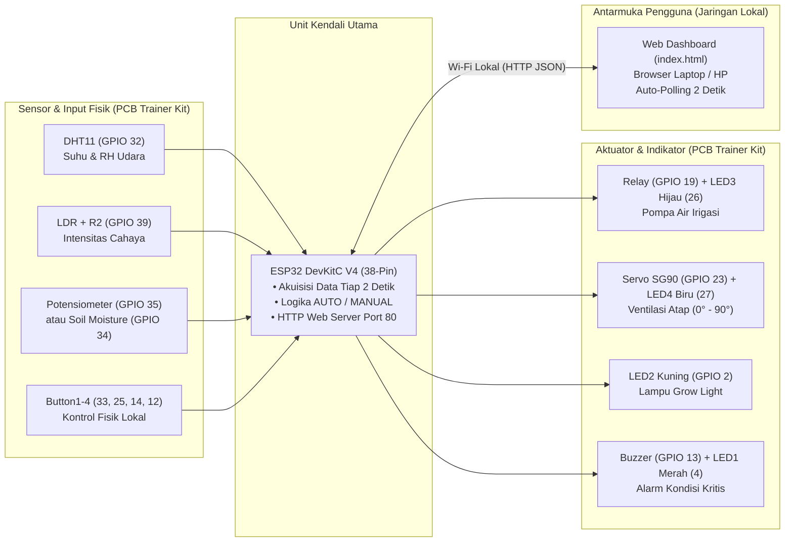

# Product Requirements Document (PRD)
## Smart Mini Greenhouse Monitoring & Control System Berbasis All-in-One Trainer Kit ESP32 DevKitC V4

---

## 1. Identitas Dokumen & Ringkasan Eksekutif

| Atribut | Keterangan |
| :--- | :--- |
| **Judul Project** | **Smart Mini Greenhouse Monitoring & Control System Berbasis All-in-One Trainer Kit ESP32 DevKitC V4 (38-Pin)** |
| **Tema Project** | *Smart Agriculture / Automated Mini Greenhouse* |
| **Versi Dokumen** | `v1.0` |
| **Konteks Akademik** | Project Akhir UAS — Mata Kuliah *Internet of Things (IoT)* |
| **Batas Pengumpulan** | 13 Desember 2026 |
| **Jadwal Presentasi** | 14 – 26 Desember 2026 |
| **Platform Utama** | ESP32 DevKitC V4 (`ESP-32D`, 38-Pin) pada PCB *All-in-One Trainer Kit* |
| **Antarmuka Pengguna** | Web Dashboard Lokal (HTML5, CSS3, JavaScript Offline-First) + Embedded Web Server Port `80` |

### Ringkasan Eksekutif
**Smart Mini Greenhouse Monitoring & Control System** adalah prototipe sistem IoT untuk memantau kondisi iklim mikro di dalam rumah kaca skala mini secara *real-time* dan mengendalikan aktuator lingkungan secara otomatis maupun manual. Sistem dibangun di atas **All-in-One Trainer Kit ESP32 DevKitC V4 (38-Pin)** sehingga seluruh jalur sensor, resistor pembagi tegangan, LED indikator, tombol fisik, Buzzer, Relay, dan Motor Servo sudah terintegrasi rapi pada papan PCB. Data sensor dikirimkan melalui jaringan Wi-Fi lokal (Hotspot HP/Router) tanpa memerlukan koneksi internet menuju Web Dashboard yang menampilkan nilai sensor beserta satuannya, status kondisi sistem, grafik *real-time*, stempel waktu pembaruan terakhir, serta panel kontrol aktuator.

---

## 2. Latar Belakang & Rumusan Masalah

### A. Latar Belakang
Keberhasilan pertumbuhan tanaman di dalam rumah kaca (*greenhouse*) sangat bergantung pada kestabilan parameter lingkungan mikro di sekitarnya, meliputi **suhu udara**, **kelembapan udara**, **intensitas cahaya matahari**, dan **kelembapan media tanam**. Tanaman budidaya mudah mengalami stres fisiologis apabila suhu ruangan terlalu tinggi akibat efek rumah kaca di siang hari, kekurangan pencahayaan saat cuaca mendung atau malam hari, maupun kekeringan media tanam karena keterlambatan penyiraman.

Pada pengelolaan *greenhouse* konvensional, pemantauan kondisi masih dilakukan secara manual dengan pengamatan langsung dan penyiraman terjadwal tanpa melihat kondisi aktual tanah. Metode ini memiliki beberapa keterbatasan mendasar:
1. Tidak ada pemantauan suhu, kelembapan, dan cahaya secara kontinu dari waktu ke waktu.
2. Tindakan penyiraman atau pembukaan ventilasi sering terlambat dilakukan saat kondisi lingkungan sudah melewati batas ideal.
3. Tidak tersedia antarmuka terpusat untuk melihat kondisi tanaman sekaligus melakukan kendali cepat dari jarak dekat melalui perangkat laptop atau *smartphone*.

Berdasarkan kebutuhan tersebut, penerapan teknologi **Internet of Things (IoT)** berbasis mikrokontroler **ESP32 DevKitC V4** menjadi solusi yang tepat guna. Dengan memanfaatkan Wi-Fi terintegrasi pada ESP32, pembacaan multi-sensor dapat dikirim secara berkala ke antarmuka Web lokal, sekaligus mengeksekusi otomasi aktuator (pompa air melalui Relay, ventilasi atap melalui Motor Servo, pencahayaan tambahan melalui LED Grow Light, dan peringatan dini melalui Buzzer) secara responsif.

### B. Rumusan Masalah
1. Bagaimana membaca dan mengkalibrasi parameter iklim mikro *greenhouse* (suhu udara, kelembapan udara, intensitas cahaya, dan kelembapan media tanam) menggunakan sensor pada **Trainer Kit ESP32 DevKitC V4**?
2. Bagaimana membangun komunikasi data yang stabil antara **ESP32** dan **Web Dashboard** melalui jaringan Wi-Fi lokal tanpa bergantung pada koneksi internet?
3. Bagaimana merancang logika pengendalian aktuator (`Relay`, `Motor Servo`, `LED`, `Buzzer`) agar dapat bekerja secara **otomatis (`AUTO`)** berdasarkan ambang batas (*threshold*) sekaligus dapat di-*override* secara **manual (`MANUAL`)** baik dari Web Dashboard maupun tombol fisik?

---

## 3. Tujuan Project & Sasaran Keberhasilan

### A. Tujuan Project
1. Merancang dan mengimplementasikan prototipe perangkat keras **Smart Mini Greenhouse** menggunakan papan **All-in-One Trainer Kit ESP32 DevKitC V4 (38-Pin)** dengan dukungan penambahan sensor eksternal (*Soil Moisture* dan Pompa Air/Kipas DC 5V).
2. Membangun server HTTP dan REST API JSON di dalam firmware ESP32 agar dapat menyajikan data pembacaan sensor dan menerima perintah kendali melalui jaringan Wi-Fi lokal (Hotspot HP/Router).
3. Menyediakan Web Dashboard responsif yang memuat seluruh informasi wajib tugas akhir (judul project, nilai & satuan sensor, status kondisi sistem, pembaruan data terakhir, indikator koneksi, grafik *real-time*, kontrol aktuator, dan mode simulasi).
4. Memastikan seluruh fungsi sistem mudah diuji dan didemonstrasikan secara langsung pada sesi presentasi UAS.

### B. Sasaran Keberhasilan (Selaras dengan Rubrik Penilaian UAS)

| Aspek Penilaian UAS | Bobot | Target Implementasi pada PRD Ini |
| :--- | :---: | :--- |
| **Kesesuaian Rancangan dengan Tujuan** | 15% | Seluruh sensor & aktuator terpetakan jelas sesuai skenario *Smart Mini Greenhouse* |
| **Keberfungsian Perangkat, Sensor & Aktuator** | 25% | `DHT11`, `LDR`, `Potensiometer`/`Soil Moisture`, `Relay`, `Servo`, `LED 1–4`, `Buzzer`, dan `Button 1–4` bekerja akurat |
| **Integrasi Jaringan & Pengiriman Data** | 25% | Komunikasi Wi-Fi lokal via HTTP REST API JSON (`GET /api/status`, `POST /api/control`, `POST /api/threshold`) stabil tiap `2 detik` |
| **Fungsi & Kemudahan Antarmuka** | 15% | Web Dashboard informatif, responsif (HP & Laptop), berjalan *offline*, dilengkapi grafik & kontrol `AUTO`/`MANUAL` |
| **Kelengkapan Laporan & Kode Program** | 10% | Kode `.ino`, Web (`HTML/CSS/JS`), panduan pinout, PRD, & draft laporan tersusun rapi |
| **Presentasi & Demonstrasi** | 10% | Seluruh skenario uji dapat dipicu instan di meja demo |

---

## 4. Rincian Lengkap Seluruh Komponen Perangkat Keras (*Hardware BOM*)

### A. Komponen Utama & Terintegrasi Aktif pada PCB Trainer Kit ESP32 V4

| No | Komponen | Spesifikasi Teknis / Label PCB | Pin GPIO | Fungsi dalam Sistem *Smart Mini Greenhouse* |
| :-: | :--- | :--- | :---: | :--- |
| 1 | **Mikrokontroler ESP32** | `ESP-WROOM-32D` / `ESP32 DevKitC V4` (38-Pin, Wi-Fi 2.4 GHz, ADC 12-bit) | — | Unit pemroses utama, pembaca sensor, eksekutor logika kontrol, dan HTTP Web Server Port `80` |
| 2 | **Sensor Suhu & Kelembapan Udara (`DHT11`)** | Modul sensor digital 1-Wire (PCB biru, kiri-atas board) | `GPIO 32` | Mengukur suhu udara (`°C`) dan kelembapan udara (`% RH`) di lingkungan *greenhouse* |
| 3 | **Sensor Cahaya (`LDR` + Resistor `R2`)** | Fotoresistor 2-kaki terpasang dengan rangkaian pembagi tegangan `R2` | `GPIO 39` (`ADC1`) | Mengukur intensitas cahaya (`0–100%`) dari pembacaan ADC `0–4095` saat Wi-Fi aktif |
| 4 | **Knop `Potensiometer`** | Resistor variabel putar (kiri-atas, label `GND / 35 / 3V3`) | `GPIO 35` (`ADC1`) | Input/simulator terukur kelembapan media tanam (`0–100%`) yang mudah diputar saat demo |
| 5 | **Modul `Relay` 5V** | `Songle SRD-05VDC-SL-C` + Terminal Baut Hijau (`NC / COM / NO`) | `GPIO 19` | Saklar elektronik otomatis untuk menyalakan/mematikan **Pompa Air Irigasi** |
| 6 | **Motor `Servo SG90`** | Micro Servo PWM `50 Hz` (`180°`, kanan-atas, label `23 / 5V / G`) | `GPIO 23` | Aktuator mekanis pembuka/penutup **Ventilasi Atap Greenhouse** (`0°` tutup ↔ `90°` terbuka) |
| 7 | **`Active Buzzer`** | Buzzer 5V/3.3V terpasang dengan transistor driver (kiri-bawah) | `GPIO 13` | Memberikan alarm suara putus-putus (*beep* tiap `450 ms`) saat status sistem `CRITICAL` |
| 8 | **`LED1` (Merah)** | LED 5mm + resistor pembatas `R6` | `GPIO 4` | Indikator visual **Alarm Kondisi Kritis** (menyala selaras dengan Buzzer) |
| 9 | **`LED2` (Kuning)** | LED 5mm + resistor pembatas `R7` | `GPIO 2` | Simulasi/Indikator **Lampu Grow Light** (menyala otomatis saat cahaya `LDR < 35%`) |
| 10 | **`LED3` (Hijau)** | LED 5mm + resistor pembatas `R8` | `GPIO 26` | Indikator visual **Pompa Air Aktif** (menyala mengikuti status Relay `GPIO 19`) |
| 11 | **`LED4` (Biru)** | LED 5mm + resistor pembatas `R9` | `GPIO 27` | Indikator visual **Ventilasi Pendingin Aktif** (menyala mengikuti Servo `GPIO 23` terbuka; berkedip saat proses koneksi Wi-Fi) |
| 12 | **`Button1` (Merah)** | Tactile Push Button + tutup kuning/merah | `GPIO 33` | Tombol fisik untuk berganti antara mode **`AUTO`** dan **`MANUAL`** |
| 13 | **`Button2` (Kuning)** | Tactile Push Button | `GPIO 25` | Tombol fisik kontrol manual **Grow Light (`LED2`)** |
| 14 | **`Button3` (Hijau)** | Tactile Push Button | `GPIO 14` | Tombol fisik kontrol manual **Pompa Air (`Relay 19` + `LED3`)** |
| 15 | **`Button4` (Biru)** | Tactile Push Button *(jangan ditekan saat boot/upload)* | `GPIO 12` | Tombol fisik kontrol manual **Ventilasi (`Servo 23` + `LED4`)** |

---

### B. Opsi Komponen Eksternal (*Plug-and-Play* ke Trainer Kit)

| No | Komponen Eksternal | Media Koneksi ke PCB Trainer Kit | Pin Target | Fungsi Tambahan |
| :-: | :--- | :--- | :---: | :--- |
| 16 | **Sensor `Soil Moisture` Asli** | 3 kabel jumper *Male-to-Female* ke soket 3-pin bekas sensor PIR (`5V \| 34 \| GND`) | `GPIO 34` (`ADC1`) | Menggantikan Potensiometer jika ingin mengukur tanah/media tanam fisik secara langsung (`#define PIN_POT_SOIL 34`) |
| 17 | **Pompa Air Mini / Kipas DC 5V** | Terminal baut sekrup hijau pada Relay (`COM` ke `+5V`, `NO` ke `+` Pompa, `-` Pompa ke `GND`) | `GPIO 19` (via Relay) | Mengalirkan air penyiraman nyata ke pot tanaman pada maket *greenhouse* |

---

### C. Inventarisasi Komponen Lain yang Terpasang di PCB Trainer Kit (Status Cadangan)

Selain komponen aktif di atas, papan **Trainer Kit ESP32 V4** Anda juga memuat komponen berikut yang berstatus **cadangan / tidak digunakan pada versi awal (`v1.0`)** agar sistem tetap fokus pada tema *Smart Mini Greenhouse*:

| No | Komponen pada PCB | Jalur Pin di PCB | Status pada `v1.0` | Potensi Pengembangan Lanjutan (`v1.1+`) |
| :-: | :--- | :---: | :--- | :--- |
| 18 | **Layar `OLED 0.96"` (`SSD1306`)** | `I2C` (`SDA: 21`, `SCL: 22`) | Cadangan | Menampilkan IP Address Wi-Fi, suhu, kelembapan, & status pompa langsung di alat |
| 19 | **Sensor `BME/BMP280`** | `I2C` (`SDA: 21`, `SCL: 22`) | Cadangan | Membaca tekanan udara (`hPa`) & suhu presisi tambahan |
| 20 | **Sensor Gerak `PIR HC-SR501`** | Soket 3-pin (`5V`, `34`, `GND`) | Cadangan (dapat dicabut untuk soket `Soil Moisture`) | Deteksi hama atau pergerakan di sekitar *greenhouse* |
| 21 | **Sensor Jarak `Ultrasonik HC-SR04`** | Soket `Trig`/`Echo` kanan-bawah | Cadangan | Mengukur ketinggian sisa air di tangki tandon irigasi |
| 22 | **Sensor Gas & Asap `MQ-2`** | Soket `MQ-2` tengah-atas | Cadangan | Deteksi dini asap/kebakaran di area *greenhouse* |
| 23 | **Display `2-Digit 7-Segment`** | Tengah PCB (di samping LED) | Cadangan | Menampilkan angka suhu atau persentase kelembapan secara lokal |

---

## 5. Arsitektur Sistem, Diagram Blok & Rangkaian Perangkat

### A. Diagram Blok Sistem



### B. Ketentuan Teknis Rangkaian ESP32
1. **Penggunaan `ADC1` untuk Sensor Analog:** Seluruh sensor analog (`LDR` pada `GPIO 39`, `Potensiometer` pada `GPIO 35`, dan opsi `Soil Moisture` pada `GPIO 34`) ditempatkan pada kanal **`ADC1`** (`GPIO 32–39`) karena pin `ADC2` dinonaktifkan oleh driver Wi-Fi ESP32 saat koneksi Wi-Fi aktif.
2. **Pengendalian Motor Servo (`GPIO 23`):** Pulsa PWM `50 Hz` (`500–2400 µs`) dikirim selama 25 siklus hanya saat sudut target berubah (`0°` ↔ `90°`), sehingga servo tidak bergetar dan tidak memblokir layanan `WebServer`.
3. **Catatan Pin *Boot/Strapping*:** `Button4` berada pada `GPIO 12` (pin *strapping* MTDI). Selama tombol tidak ditekan saat menyalakan daya atau proses *Upload*, ESP32 akan melakukan *booting* dengan normal.

---

## 6. Kebutuhan Fungsional & Logika Operasi (*Functional Requirements*)

### FR-01: Akuisisi Data Sensor Berkala
* Sistem membaca seluruh sensor setiap **`2000 ms` (2 detik)** dengan rata-rata 5 sampel pembacaan untuk input analog (`LDR` dan `Potensiometer`/`Soil Moisture`) guna meredam *noise*.
* Satuan data yang dihasilkan:
  * Suhu Udara: **`°C`** (1 angka desimal, misal `28.5 °C`)
  * Kelembapan Udara: **`% RH`** (1 angka desimal, misal `65.0 % RH`)
  * Intensitas Cahaya (`LDR`): **`%`** (`0–100%`)
  * Kelembapan Media Tanam: **`%`** (`0–100%`)

### FR-02: Logika Pengendalian Otomatis (`Mode AUTO`)
Dengan nilai ambang batas (*threshold*) awal yang dapat diubah sewaktu-waktu melalui Web Dashboard:
* `threshMaxTemp = 31.0 °C`
* `threshMinSoil = 40 %`
* `threshMinLight = 35 %`

Aturan otomasi aktuator pada mode **`AUTO`**:
1. **Pencahayaan Otomatis:** Jika `lightPercent < threshMinLight` → **`LED2` Kuning (`Grow Light`) = `ON`**.
2. **Pendinginan / Ventilasi Otomatis:** Jika `temperatureC > threshMaxTemp` → **`Motor Servo` bergerak ke `90°`** dan **`LED4` Biru = `ON`**. Jika suhu kembali `<= threshMaxTemp`, Servo menutup ke `0°`.
3. **Irigasi Otomatis:** Jika `soilMoisture < threshMinSoil` → **`Relay` (`Pompa Air`) = `ON`** dan **`LED3` Hijau = `ON`**.
4. **Alarm Kondisi Kritis:** Jika `temperatureC >= (threshMaxTemp + 2.0)` **ATAU** (`temperatureC > threshMaxTemp` **DAN** `soilMoisture < threshMinSoil`) → **`Buzzer` = `ON` (bunyi putus-putus)** dan **`LED1` Merah = `ON`**.

### FR-03: Logika Pengendalian Manual (`Mode MANUAL`)
* Pengguna dapat beralih ke mode **`MANUAL`** melalui tombol di Web Dashboard, mengirim request ke API kontrol, atau menekan tombol fisik **`Button1` (`GPIO 33`)** / tombol **`Button2–4`**.
* Di mode `MANUAL`, status aktuator (`Pompa/Relay`, `Ventilasi/Servo`, `Grow Light/LED2`, `Buzzer/LED1`) sepenuhnya mengikuti perintah pengguna sampai dikembalikan ke mode `AUTO`.

### FR-04: Klasifikasi Status Kondisi Sistem (Pemenuhan Poin B.5 Soal UAS)

| Prioritas | Kondisi Pemicu | `alertLevel` | Teks `systemStatus` yang Ditampilkan |
| :-: | :--- | :---: | :--- |
| 1 | Suhu `>= maxTemp + 2.0 °C` atau (Suhu `> maxTemp` & Tanah `< minSoil`) | `CRITICAL` | **`KRITIS - Suhu Panas & Tanah Kering`** |
| 2 | Tanah `< minSoil` dan Cahaya `< minLight` | `ACTIVE` | **`MENYIRAM & GROW LIGHT AKTIF - Tanah Kering & Cahaya Kurang`** |
| 3 | Tanah `< minSoil` | `ACTIVE` | **`MENYIRAM - Tanah Kering`** |
| 4 | Suhu `> maxTemp` | `ACTIVE` | **`PENDINGINAN AKTIF - Suhu Tinggi (Ventilasi Servo Terbuka)`** |
| 5 | Cahaya `< minLight` | `ACTIVE` | **`GROW LIGHT AKTIF - Cahaya Kurang`** |
| 6 | Mode `MANUAL` & ada aktuator menyala saat lingkungan ideal | `ACTIVE` | **`KONTROL MANUAL AKTIF - Kondisi Lingkungan Ideal`** |
| 7 | Seluruh parameter berada di rentang ideal | `NORMAL` | **`NORMAL - Kondisi Greenhouse Ideal`** |

---

## 7. Spesifikasi Jaringan & Kontrak REST API

### A. Topologi Jaringan Lokal
* **Mode Wi-Fi:** `WIFI_STA` (*Station Mode*) terhubung ke **Hotspot Smartphone** atau **Router Wi-Fi Lokal**.
* **Kemandirian Internet:** Tidak memerlukan internet/cloud broker eksternal. Laptop atau *smartphone* pengakses Web Dashboard cukup terhubung ke jaringan Wi-Fi yang sama dengan ESP32.
* **Dukungan CORS:** Seluruh endpoint menyertakan header `Access-Control-Allow-Origin: *` dan handler `HTTP OPTIONS` (`204`) agar file lokal `web-dashboard/index.html` dapat memanggil API ESP32 secara langsung dari browser.

### B. Daftar Endpoint REST API (Port `80`)

| Method | Endpoint | Fungsi | Parameter / Payload |
| :---: | :--- | :--- | :--- |
| `GET` | `/` | Halaman web ringkas tertanam di memori ESP32 | — |
| `GET` | `/api/status` | Mengambil seluruh data sensor, aktuator, threshold, dan status sistem | — |
| `POST` / `GET` | `/api/control` | Mengubah mode (`AUTO`/`MANUAL`) atau kendali aktuator | `mode`, `pump`, `fan`, `growLight`, `buzzer` |
| `POST` / `GET` | `/api/threshold` | Memperbarui ambang batas otomatis secara *real-time* | `maxTemp` (`15–50`), `minSoil` (`5–95`), `minLight` (`5–95`) |

#### Contoh Respons JSON `GET /api/status`:
```json
{
  "project": "Smart Mini Greenhouse Monitoring & Control System",
  "device": "Trainer Kit ESP32 DevKit V4 (38-Pin)",
  "connected": true,
  "ip": "192.168.43.105",
  "rssi": -54,
  "uptimeSeconds": 182,
  "mode": "AUTO",
  "alertLevel": "ACTIVE",
  "systemStatus": "MENYIRAM - Tanah Kering",
  "dhtValid": true,
  "soilSource": "EXTERNAL_ADC",
  "servoAngle": 0,
  "sensors": {
    "temperature": 29.4,
    "humidity": 64.0,
    "light": 72,
    "soil": 32,
    "rawLdr": 2949,
    "rawSoil": 1310
  },
  "actuators": {
    "pump": true,
    "fan": false,
    "growLight": false,
    "buzzer": false
  },
  "thresholds": {
    "maxTemp": 31.0,
    "minSoil": 40,
    "minLight": 35
  }
}
```

---

## 8. Spesifikasi Antarmuka Pengguna (*Web Dashboard*)

Antarmuka pada [web-dashboard/index.html](../web-dashboard/index.html) dirancang *offline-first* (tanpa dependensi CDN eksternal) dengan persyaratan tampilan sebagai berikut:

1. **Header Identitas & Koneksi (Wajib Poin B.5):**
   * Menampilkan judul project: **Smart Mini Greenhouse Monitoring & Control System**.
   * Menampilkan badge indikator status perangkat: `TERHUBUNG KE ESP32` (hijau), `MODE SIMULASI` (biru), atau `TERPUTUS` (merah) beserta IP & kekuatan sinyal (`RSSI`).
   * Menampilkan waktu pembaruan data terakhir (`HH:MM:SS`) yang diperbarui otomatis setiap **2 detik**.
2. **Banner Status Kondisi Sistem (Wajib Poin B.5):**
   * Berubah warna secara dinamis sesuai `alertLevel`: Hijau (`NORMAL`), Amber/Kuning (`ACTIVE`), Merah (`CRITICAL`).
3. **4 Kartu Pembacaan Sensor + Satuan (Wajib Poin B.5):**
   * Suhu Udara (`°C`), Kelembapan Udara (`% RH`), Intensitas Cahaya LDR (`%`), dan Kelembapan Media Tanam (`%`), lengkap dengan *progress bar* dan label ambang batas.
4. **Grafik Pemantauan *Real-Time*:**
   * Grafik multi-garis berbasis HTML5 `<canvas>` lokal yang memplot hingga 25 titik riwayat terbaru dari keempat sensor.
5. **Panel Visualisasi & Kontrol Aktuator + Pengaturan Threshold:**
   * Tombol saklar mode `AUTO` / `MANUAL`, tombol kontrol langsung untuk `Relay Pompa`, `Ventilasi/Kipas`, `Grow Light`, dan `Buzzer`, serta form input pengubah nilai threshold.
6. **Panel Simulator Demo (Dual-Mode):**
   * Tersedia preset skenario (*Kondisi Ideal*, *Siang Terik*, *Malam Hari*, *Tanah Kering*, *Kondisi Kritis*) dan slider sensor manual untuk menguji tampilan maupun cadangan presentasi tanpa ketergantungan perangkat fisik.

---

## 9. Rencana Pengujian & Kriteria Penerimaan (*Acceptance Criteria*)

Sesuai **Bagian D (Pengujian dan Presentasi)** pada dokumen soal, sistem dinyatakan siap presentasi apabila seluruh skenario pengujian berikut terpenuhi:

| ID Uji | Aspek yang Diuji | Prosedur Pengujian | Kriteria Penerimaan (*Pass Criteria*) |
| :---: | :--- | :--- | :--- |
| **TC-01** | Koneksi Jaringan Lokal | Nyalakan Hotspot HP, nyalakan ESP32, cek Serial Monitor & Web Dashboard | ESP32 memperoleh IP lokal dan Web Dashboard berstatus `TERHUBUNG KE ESP32` |
| **TC-02** | Pembaruan Otomatis | Diamkan sistem selama 10 detik dan amati Web Dashboard | Timestamp `Pembaruan Terakhir` dan titik grafik bertambah otomatis tiap 2 detik |
| **TC-03** | Sensor LDR & Grow Light | Tutup sensor `LDR` (`GPIO 39`) menggunakan jari hingga cahaya `< 35%` | `LED2` Kuning (`GPIO 2`) menyala, status web menjadi `GROW LIGHT AKTIF - Cahaya Kurang` |
| **TC-04** | Input Kelembapan Tanah & Relay | Putar knop `Potensiometer` (`GPIO 35`) ke nilai `< 40%` | `Relay` (`GPIO 19`) berbunyi *"klik"*, `LED3` Hijau (`GPIO 26`) menyala, status web menjadi `MENYIRAM - Tanah Kering` |
| **TC-05** | Sensor DHT11 & Servo Ventilasi | Hembuskan udara hangat ke `DHT11` (`GPIO 32`) hingga suhu `> 31.0 °C` | `Servo` (`GPIO 23`) berputar membuka ke `90°`, `LED4` Biru (`GPIO 27`) menyala, status web menjadi `PENDINGINAN AKTIF` |
| **TC-06** | Kondisi Kritis & Alarm | Buat kondisi suhu `> 31.0 °C` dan tanah `< 40%` bersamaan | Banner web merah (`KRITIS`), `LED1` Merah (`GPIO 4`) menyala, `Buzzer` (`GPIO 13`) berbunyi *beep* |
| **TC-07** | Kontrol Manual Web & Tombol Fisik | Ubah ke `MANUAL` lalu klik tombol di Web atau tekan `Button2`/`Button3`/`Button4` | Aktuator (`Relay`, `Servo`, `LED2`, `Buzzer`) langsung merespons sesuai perintah |

---

## 10. Lampiran Referensi Berkas Project

* Kode Program ESP32: [smart_greenhouse_esp32.ino](../firmware/smart_greenhouse_esp32/smart_greenhouse_esp32.ino)
* Antarmuka Web Dashboard: [index.html](../web-dashboard/index.html), [style.css](../web-dashboard/style.css), [app.js](../web-dashboard/app.js)
* Panduan Pinout & Demo Board: [PANDUAN_BOARD_DAN_PINOUT.md](./PANDUAN_BOARD_DAN_PINOUT.md)
* Draft Laporan Pengumpulan UAS: [DRAFT_LAPORAN_UAS.md](./DRAFT_LAPORAN_UAS.md)
